Install it and Marketing Cloud gets easier to work in. Nothing to set up, nothing to log in to.

Free, from the Chrome Web Store.

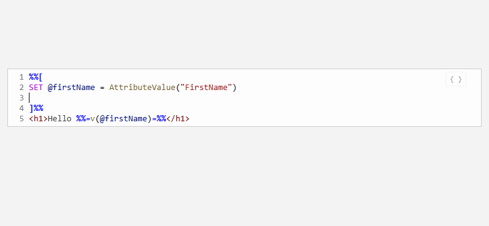

## What you get

- **Code editors you can read:** AMPscript and SSJS in colour, in a light or dark theme.
- **Help while you type:** suggestions, explanations when you point at code, and mistakes underlined before you save.
- **Tidy code with one click:** the **{ }** button or **Shift+Alt+F**, and **Ctrl+S** saves.
- **Readable keys instead of random ones:** new automations, activities, data extensions, journeys and more get a key made from their name, such as `Welcome_series`.
- **No more "New Journey - 18 November…":** Journey Builder asks for a real name before a new journey is saved.
- **Transactional SMS, push and OTT messages in a list:** a new entry in the Mobile Studio menu shows them and lets you create, change and delete them. Marketing Cloud itself has no place for this.
- **Small fixes for everyday annoyances:** select all scopes of an installed package with one click, and a pasted name or key that Marketing Cloud would ignore is used.
- **Private:** nothing is collected and nothing leaves Marketing Cloud.



## Where it works

- **Marketing Cloud Engagement:** Content Builder, Email Studio, CloudPages, Automation Studio, Journey Builder, Contact Builder, Mobile Studio and Setup.
- **Marketing Cloud Next:** the code of an email made with **Create with HTML**, and the **HTML** component in emails, landing pages and content blocks. There the extension helps with AMPscript; colours and Handlebars are left to Salesforce.

## Code you can read

Marketing Cloud colours HTML but shows AMPscript as plain black text. The extension gives AMPscript and SSJS their own colours.

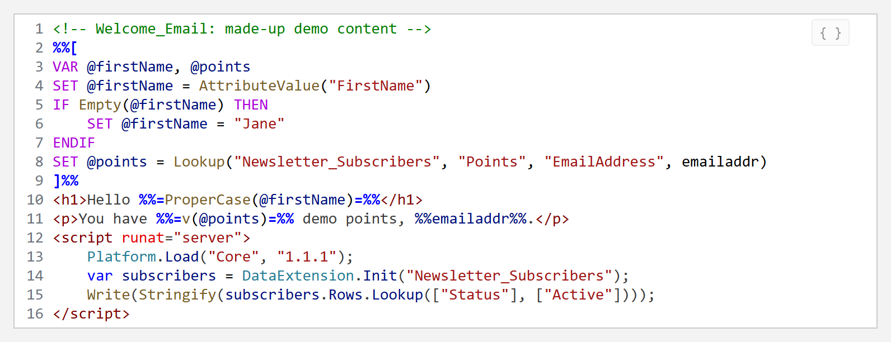

- **Light or dark:** pick the theme in the options; the code editors follow.

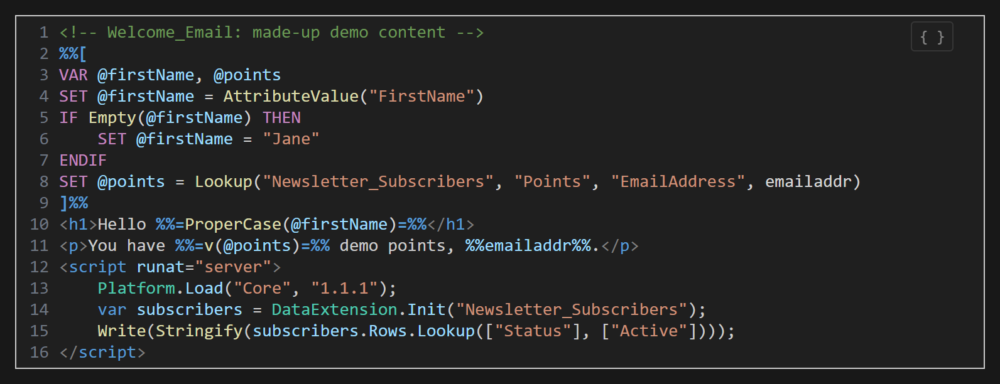

## Help while you type

- **Suggestions:** functions, keywords and your own variables, each with a short description.
- **Explanations:** rest the mouse on a function and a box says what it does, what it needs and shows an example.

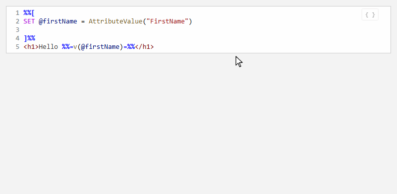

- **Mistakes underlined before you save:** a misspelt function, a missing bracket, or something that will not work in the place you are writing it.

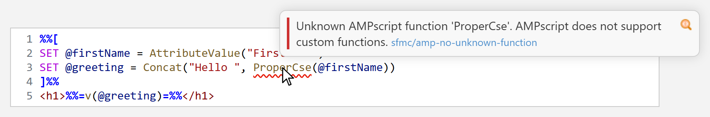

- **One-click fixes:** where the extension knows the fix, the box offers it as a button.

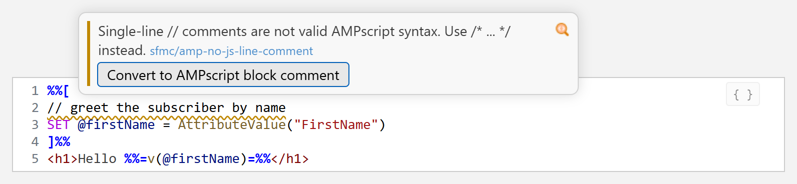

## Tidy code with one click

- **The { } button** or **Shift+Alt+F** indents and spaces your code the same way every time.
- **Ctrl+S** saves, like everywhere else.

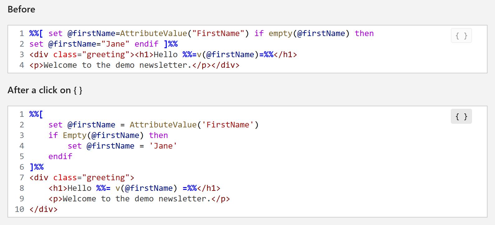

## Readable keys

Marketing Cloud gives most new things a random key. The extension fills in a key made from the name while you type it, and you can still change it.

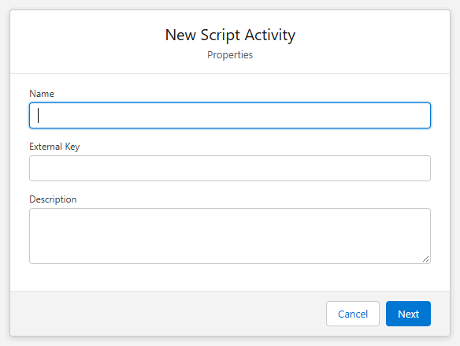

- **Where:** automations and their activities, data extensions, data filters, triggered sends, journeys and their API events, content blocks and emails, sender profiles, send classifications, delivery profiles, file locations, roles and users.

## A real name for every journey

Journey Builder calls every new journey "New Journey" with a date. The extension asks for a name of your own before the journey is saved.

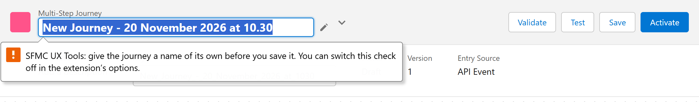

## Transactional messages in a list

Transactional SMS, push and OTT messages exist in Marketing Cloud, but only its API shows them. The extension adds **Transactional Messages** to the Mobile Studio menu.

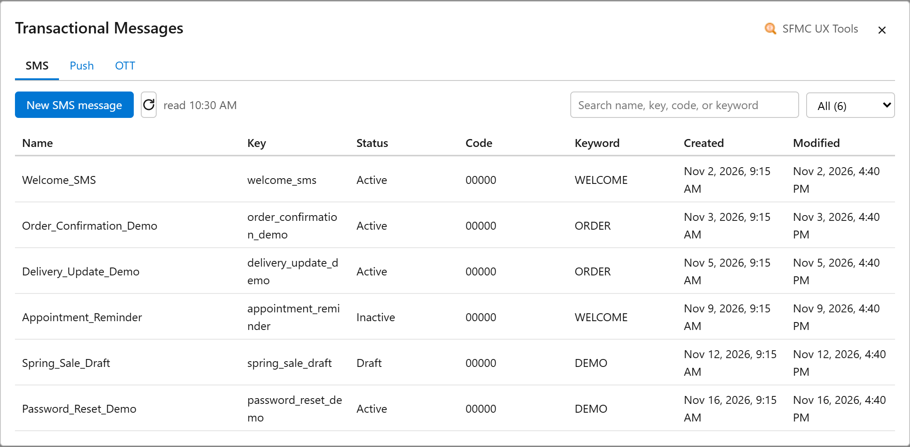

- **One tab per channel:** SMS, push and OTT, each with search and a filter by status.
- **Create, change and delete:** in forms that know your account's codes, keywords, apps and contents.
- **Details that explain themselves:** a push message shows its app and its content by name, with links to both.

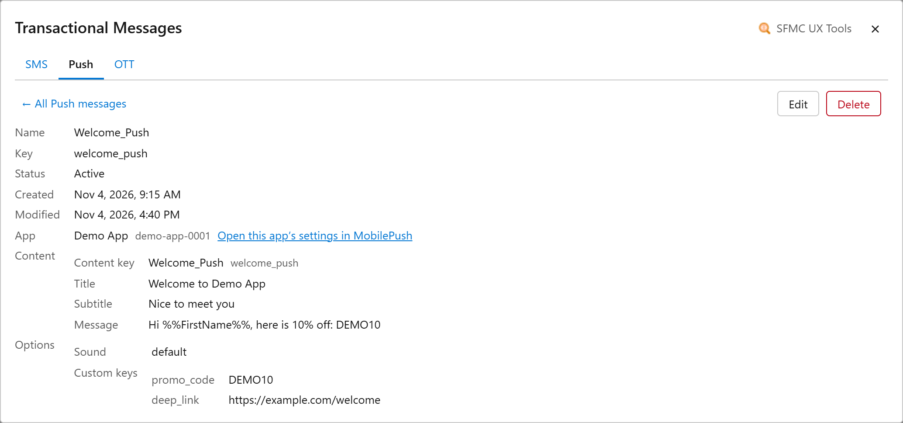

## Small fixes

- **Select all scopes:** the scope list of an installed package gets a **Select all** button.

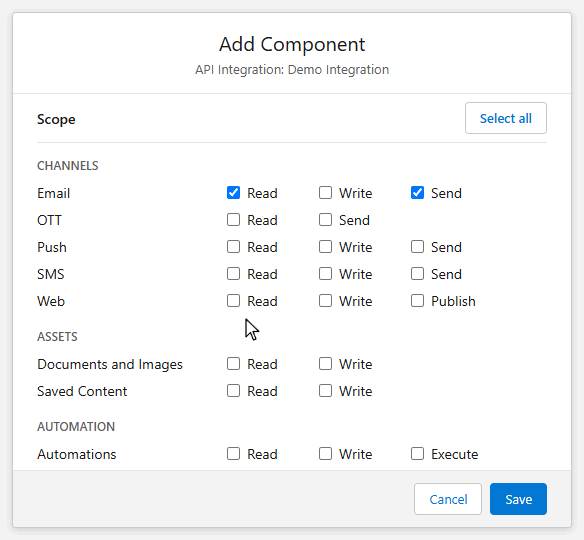

- **Pasting with the mouse works:** a name or key pasted from the right-click menu is used, where Marketing Cloud would ignore it.

## Privacy

Nothing is collected and nothing leaves Marketing Cloud. The extension only talks to the Marketing Cloud pages you are signed in to.

## Related

The language help comes from the same catalogs as the [SFMC Language Service](/tools/vscode-sfmc-language/) for VS Code and [prettier-plugin-sfmc](/tools/prettier-plugin-sfmc/).

## Links

- [Chrome Web Store](https://chromewebstore.google.com/detail/icngdchkbniamebbmhebciohjimfmjej)
- [Full feature list on GitHub](https://github.com/JoernBerkefeld/chrome-sfmc-ux-tools#readme)

[← All tools](/tools/)
